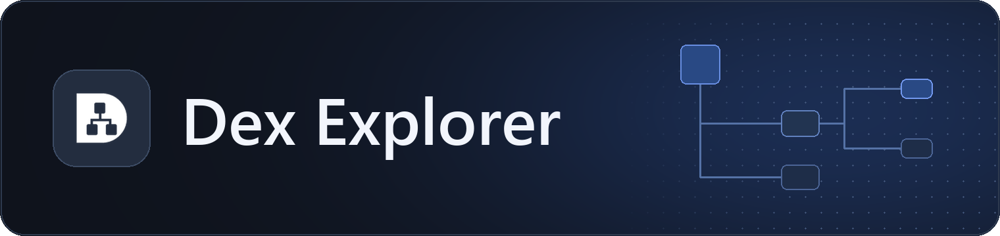

<h1 align="center">
  
</h1>

<p align="center">An in-game Explorer for Roblox</p>

<p align="center">
  <a href="#run-dex"><strong>Run Dex</strong></a>
  &nbsp;·&nbsp;
  <a href="#tools">Tools</a>
  &nbsp;·&nbsp;
  <a href="#performance">Performance</a>
  &nbsp;·&nbsp;
  <a href="docs/mcp/SETUP.md">Dex MCP</a>
  &nbsp;·&nbsp;
  <a href="docs/PLUGINS.md">Plugins</a>
  &nbsp;·&nbsp;
  <a href="BUILDING.md">Build from source</a>
</p>

## Run Dex

Paste this into your executor.

```lua
loadstring(game:HttpGet("https://raw.githubusercontent.com/wooxps/dex-explorer/main/loader.lua"))()
```

<p align="center">
  
</p>

## Tools

- **Explorer and Properties** let you search for objects and edit several at once. Try `is:BasePart and Anchored=false` to find unanchored parts.
- **Script Editor** has Luau autocomplete and shows types when you hover over code. Ctrl-click a name to jump to its definition.
- **Find in Place** searches across scripts. Click a result to go to that line, or use **Replace All** to edit matches in the editor.
- **Asset Manager** previews images, sounds, meshes, and animations and shows where they're used. Open a model in **3D Viewer** to see it on its own.
- **Console** shows client logs and has a Luau command bar.
- **Input Macros** record and replay keyboard and mouse input. Change the speed, edit delays, or loop the recording. Press **F8** to stop.

<details>
<summary>More tools</summary>

- Pick a part or UI element to select it in Explorer. Move, rotate, or resize it with the transform handles.
- Right-click an object to find references to it or watch it for changes.
- **Save Instance** exports objects to a file. **Reconstructor** shows inferred paths and where they came from.

</details>

## Plugins and Dex MCP

[Plugins](docs/PLUGINS.md) can add buttons, windows, shortcuts, and right-click actions to Dex.

[Dex MCP](docs/mcp/SETUP.md) connects Dex to Codex or another MCP client. The **Commands** tab lets you turn tools on or off. **Activity** shows what ran and what it returned.

Script source, file saves, and input playback depend on your executor.

## Performance

| Feature | Result |
| :--- | :--- |
| **Finding objects** | **Over 1,000× faster than Moon's Dex** when repeating the same search in a test with 70,000 matches. The first search took **1.6 seconds**. |
| **Filtering assets** | Eight filter changes on 20,000 assets took **0.06 seconds** with the list already sorted and **1.2 seconds** when sorting it each time. |
| **Editing long scripts** | Updating code colors for ten edits in a 10,000-line script took **under 1 ms** total. Coloring the whole file after each edit took about **0.2 seconds**. |

<details>
<summary>Test details</summary>

Median of three runs on an Intel i7-12700H. The tests use sample data and measure time spent in the search, filter, and highlighting code.

The repeat-search comparison used Moon's Dex's plain name search and Dex Explorer's saved results on the same unchanged tree. Median over five batches was 126 ms per search in Moon's Dex and 0.04 ms in Dex Explorer.

- [Object search](tests/search_engine.spec.luau)
- [Asset filters](tests/asset_query.spec.luau)
- [Script highlighting](tests/editor_highlight_checks.py)

</details>

## Credits

Developed by [Wooxps](https://github.com/wooxps).

Based on [Dex++ by Chillz](https://github.com/AZYsGithub/DexPlusPlus) and [Moon's Dex](https://github.com/LorekeeperZinnia/Dex). [MIT License](LICENSE).
