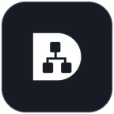

<p align="center">
  
</p>

<h1 align="center">Dex Explorer</h1>

<p align="center">An in-game Explorer for Roblox</p>

<p align="center">
  <a href="#run-dex">Quick start</a> &nbsp;·&nbsp;
  <a href="docs/mcp/SETUP.md">Dex MCP</a> &nbsp;·&nbsp;
  <a href="docs/PLUGINS.md">Plugins</a> &nbsp;·&nbsp;
  <a href="BUILDING.md">Build from source</a>
</p>

## Run Dex

Paste this into your executor.

```lua
loadstring(game:HttpGet("https://raw.githubusercontent.com/wooxps/dex-explorer/main/loader.lua"))()
```

## Tools

- **Explorer & Properties** · Browse the hierarchy and edit objects.
- **Script Editor & Find in Place** · Read scripts and jump to search matches.
- **Asset Manager & 3D Viewer** · Browse assets and preview objects.
- **Input Macros** · Record and replay input.

## Credits

Based on [Dex++ by Chillz](https://github.com/AZYsGithub/DexPlusPlus) and [Moon's Dex](https://github.com/LorekeeperZinnia/Dex). [MIT License](LICENSE).
