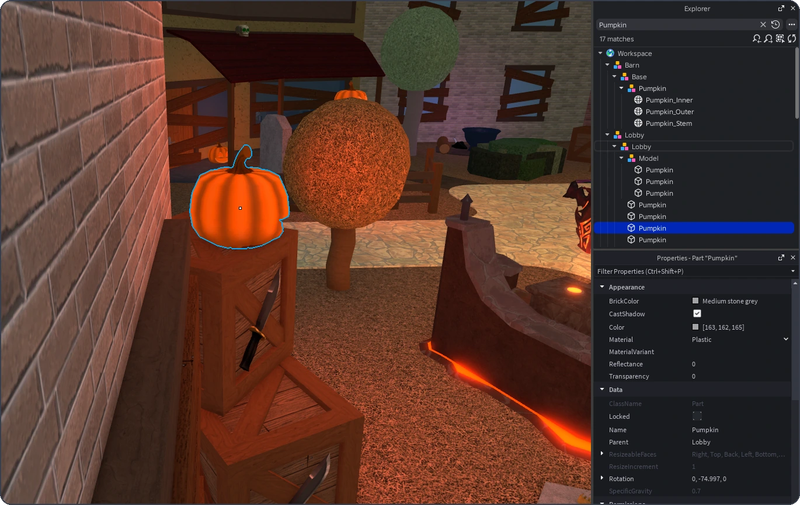

<h1 align="center">
  
</h1>

<p align="center">An in-game Explorer for Roblox</p>

<p align="center">
  <a href="#run-dex"><strong>Run Dex</strong></a>
  &nbsp;·&nbsp;
  <a href="#tools">Tools</a>
  &nbsp;·&nbsp;
  <a href="docs/mcp/SETUP.md">Dex MCP</a>
  &nbsp;·&nbsp;
  <a href="docs/PLUGINS.md">Plugins</a>
  &nbsp;·&nbsp;
  <a href="BUILDING.md">Build from source</a>
</p>

## Run Dex

Paste this into your executor.

```lua
loadstring(game:HttpGet("https://raw.githubusercontent.com/wooxps/dex-explorer/main/loader.lua"))()
```

<p align="center">
  
</p>

## What changed

- **Workspace.** Studio-style docking, resizable panels, and a saved window layout. Explorer starts with the common services, with more available under **Show Services**.
- **Large places.** Explorer draws rows as they come into view and updates changed branches. Search reuses work as you type, and the Script Editor updates highlighting around your edits.
- **Editing.** Luau autocomplete, type information on hover, Ctrl-click to go to a definition, and formatting as you type or paste. **Find in Place** has its own window for searching across scripts.

## Tools

| Tool | What you can do |
| :--- | :--- |
| **Explorer & Properties** | Search by name, class, tag, or property. Try `is:BasePart and Anchored=false` to find unanchored parts. Edit properties, attributes, and tags across a selection. |
| **Script Editor & Find in Place** | Open scripts in tabs, search with regex or whole-word matching, and jump straight to a match. Replace All applies changes in the editor buffers. |
| **Console** | Read client output, filter by text or message type, and run Luau from the command bar. |
| **Asset Manager & 3D Viewer** | Browse images, sounds, meshes, and animations. Preview assets, find the objects that use them, or open a model in a separate 3D view. |
| **Input Macros** | Record keyboard and mouse input, edit the timing, and replay it at a different speed or on a loop. Press **F8** to stop. |

<details>
<summary>More tools</summary>

- **Selection & transforms.** Pick a part or UI element on screen to reveal it in Explorer. Move, rotate, or resize selected objects.
- **Find References & View Activity.** Right-click an object to look for references to it or watch its properties, attributes, and children change.
- **Save Instance.** Export a selection or a place copy to your workspace. Choose Universal (USSI) or your executor's save provider.
- **Reconstructor.** Browse inferred paths and the evidence Dex used to group them.
- **Spy.** Opens Cobalt Spy from the tool menu.

</details>

## Plugins and Dex MCP

- **[Plugins](docs/PLUGINS.md)** add toolbar buttons, windows, shortcuts, and context actions. The guide includes a small starter plugin and explains how to use Plugin Output.
- **[Dex MCP](docs/mcp/SETUP.md)** connects a desktop MCP client to Dex. Choose what the client can inspect or change, turn individual commands on or off, and review calls and results in **Activity**.

Dex shows what the Roblox client can access. Script source, local file saves, and input playback depend on executor support.

## Credits

Developed by [Wooxps](https://github.com/wooxps).

Based on [Dex++ by Chillz](https://github.com/AZYsGithub/DexPlusPlus) and [Moon's Dex](https://github.com/LorekeeperZinnia/Dex). [MIT License](LICENSE).
